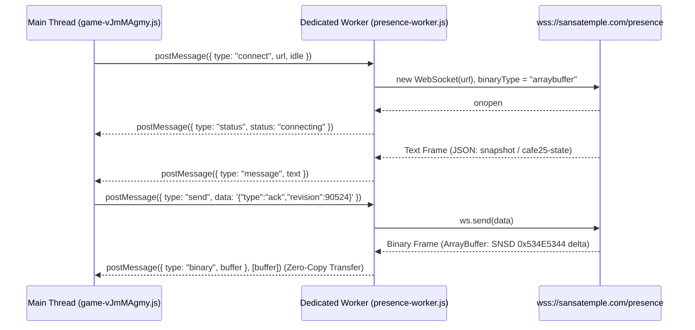

# 02. 멀티플레이어 프레즌스 & `SNSD` 하이브리드 바이너리 프로토콜 명세

> **근거 증거 (Evidence IDs)**:
> - `ev_4086dde464e9b39caa6eb04e1572ae9c8eab322aa3c4e8a746acbf64241a506d` (실시간 WebSocket 핸드셰이크 및 송수신 프레임 263건)
> - `ev_88ba890507c24458b1f176133a7cf9b7dc45571aafadaf54ee2a7d0410f4bceb` (`presence-worker-D7eFbKrZ.js`, `game-vJmMAgmy.js` 내 `class De` 및 `class Jy`)
> - `ev_5f4a20b7f2f7716c64312798bd576702bdefaba533dae6bdf6e042e0561b0e69` (`GET /api/rooms?roomLimit=100` 응답 원문 및 `cloud-presence-DTocDxb1.js` 원문)

---

## 1. 멀티룸 디렉토리 구조 (`GET /api/rooms?roomLimit=100`, `Observed`)

`sansatemple.com`은 총 **100개의 서버(룸)**를 운영하며, 각 서버당 최대 정원(`capacity`)은 **100명**(전체 동시 수용 인원 **10,000명**)입니다.

### 1.1 룸 ID 규칙
* **서버 1**: `"maru"` (`number: 1`)
* **서버 2 ~ 100**: `"maru-02"`, `"maru-03"`, ..., `"maru-99"`, `"maru-100"` (`number: 2 ~ 100`)

### 1.2 실제 캡처된 응답 스키마 (`ev_5f4a20b7...`)
```json
{
  "ok": true,
  "rooms": [
    { "id": "maru", "number": 1, "capacity": 100, "count": 65 },
    { "id": "maru-02", "number": 2, "capacity": 100, "count": 3 },
    { "id": "maru-03", "number": 3, "capacity": 100, "count": 2 },
    "... (중략) ...",
    { "id": "maru-100", "number": 100, "capacity": 100, "count": 1 }
  ]
}
```
* 클라이언트가 `room=auto`로 접속하면 서버는 정원(100명) 미달인 가장 앞 번호 룸(주로 `maru`)에 자동 배정하며, 사용자가 좌측 상단 `#visitor-counter` 버튼을 눌러 `#server-picker-dialog` 모달에서 원하는 서버(1~100)로 즉시 이동(`switchRoom`)할 수 있습니다.

---

## 2. Dedicated WebSocket Worker 브릿지 (`presence-worker-D7eFbKrZ.js`, `Observed`)

메인 UI/WebGL 스레드의 프레임 드랍을 막기 위해 WebSocket 연결 관리, 지수 백오프 재연결, 바이너리 버퍼 전달은 별도 워커(`presence-worker-D7eFbKrZ.js`, `3,489` bytes)에서 수행됩니다.



### 2.1 워커 제어 메시지 규격 (Main ➔ Worker)
* `{ type: "connect", url: string, idle: boolean }`: 지정된 WebSocket URL로 연결 시작.
* `{ type: "send", data: string | ArrayBuffer }`: 현재 열린 소켓(`readyState === 1`)으로 패킷 전송.
* `{ type: "set-idle", idle: boolean }`: 유휴 상태 전환(유휴 시 재연결 타이머 중단).
* `{ type: "disconnect", clearUrl: boolean }`: 연결 종료.
* `{ type: "dispose" }`: 워커 완전 정리.

### 2.2 워커 이벤트 메시지 규격 (Worker ➔ Main)
* `{ type: "status", status: "connecting" | "connected" | "disconnected" | "full" }`
* `{ type: "message", text: string }`: JSON 텍스트 프레임 수신.
* `{ type: "binary", buffer: ArrayBuffer }`: `Transferable` 배열(`[buffer]`)을 통해 메인 스레드로 **복사 비용 없이(Zero-copy)** 소유권 이전.
* **지수 백오프 재연결 수식**:
  $$\text{delayMs} = \min\left(15{,}000,\; 700 \times 2^{\min(\text{attempt},\, 5)} + \text{rand}(0, 350)\right)$$

---

## 3. WebSocket 연결 엔드포인트 및 쿼리 파라미터 (`Observed`)

실제 캡처된 WebSocket 연결 URL (`ev_4086dde4...` sequence `65`):
```text
wss://sansatemple.com/presence?roomLimit=100&garden=2&room=auto&protocol=2&wire=3&cafe25=1&flow=latest-v1&interest=1&resume=1&entryIdle=1&wake=1&elastic=1
```

| 쿼리 키 | 값 | 의미 (`Observed` in `game-vJmMAgmy.js`) |
| :--- | :---: | :--- |
| `roomLimit` | `100` | 최대 룸 개수 (1~100) |
| `garden` | `2` | 외부 마당 v2 확장 맵(서호, 연꽃 연못, CAFE25 좌석 포함) 활성화 |
| `room` | `auto` / `maru-XX` | 자동 배정 또는 특정 서버 지정 |
| `protocol` | `2` | 프레즌스 상태 프로토콜 v2 |
| `wire` | `3` | **`SNSD` (`0x534E5344`) 바이너리 델타 프레임 전송 활성화** |
| `cafe25` | `1` | CAFE25 커피 공양 실시간 상태(`cafe25-state`) 동기화 활성화 |
| `flow` | `latest-v1` | 최신 리비전 ACK 기반 흐름 제어 활성화 |
| `interest` | `1` | 카메라/공간 기반 AOI(Area of Interest) 바운딩 박스 필터링 활성화 |
| `resume` | `1` | 일시 단절 시 세션/좌석 복구 지원 |
| `entryIdle` | `1` | 인트로 화면 대기 중에는 유휴 상태로 입장 후 `entry-active` 수신 시 활성화 |
| `wake` / `elastic` | `1` | 유휴 깨우기 및 탄력적 브로드캐스트 틱 조절 지원 |

---

## 4. 클라이언트 ➔ 서버 송신 메시지 규격 (JSON, `Observed`)

클라이언트(`class Jy`)가 서버로 전송하는 실제 캡처 프레임(`ev_4086dde4...` sequence `174`~`176`) 및 코드 내 정의된 메시지 타입은 다음과 같습니다:

| `type` | 페이로드 예시 (`Observed`) | 설명 |
| :--- | :--- | :--- |
| **`interest`** | `{"type":"interest","bounds":{"minX":-56,"maxX":56,"minZ":-40,"maxZ":64},"requestId":1}` | 현재 플레이어가 보고 있는 영역(마당/법당 바운딩 박스)을 서버에 알려 해당 영역 내 방문객 델타만 수신 |
| **`ack`** | `{"type":"ack","revision":90524}` | 서버가 보낸 `snapshot` 또는 바이너리 델타의 `revision` 수신 확인 (`flow=latest-v1`) |
| **`entry-active`** | `{"type":"entry-active"}` | 인트로 화면(`#entry`)에서 `들어가기`를 눌러 실제 3D 월드 활동을 시작함을 알림 |
| **`move`** | `{"type":"move","x":0,"z":48,"yaw":-0.18,"pose":"walk"}` | 위치(`x`, `z`), 바라보는 각도(`yaw`, 라디안), 포즈(`"walk" \| "kneel" \| "beads" \| "dance"`) 업데이트 |
| **`hello`** | `{"type":"hello"}` | 합장 인사 수행 브로드캐스트 요청 |
| **`bow`** | `{"type":"bow"}` | 절하기 수행 시작 브로드캐스트 요청 |
| **`bead`** | `{"type":"bead"}` | 염주 돌리기 수행 브로드캐스트 요청 |
| **`seat`** | `{"type":"seat","cushion":12}` (또는 야외 벤치 슬롯 ID) | 법당 좌복 또는 마당 벤치 착석 요청 |
| **`stand`** | `{"type":"stand"}` | 좌복/벤치에서 일어나기 요청 |
| **`incense`** | `{"type":"incense","action":"join" \| "leave" \| "offer"}` | 불단 헌향 대기열 참가/취소/헌향 완료 |
| **`cafe25`** | `{"type":"cafe25","action":"brew" \| "share" \| "claim", ...}` | CAFE25 커피 내리기, 무소유 나눔 등록, 나눔 커피 받기 |

---

## 5. 서버 ➔ 클라이언트 수신 메시지 규격 (JSON + `SNSD` Binary, `Observed`)

### 5.1 초기 스냅샷 (`type: "snapshot"`, JSON)
연결 직후 서버가 첫 번째 프레임으로 전송하는 전체 방 상태(`ev_4086dde4...` sequence `69`):

```json
{
  "type": "snapshot",
  "room": "maru",
  "region": "apac",
  "instance": "0",
  "selfId": "bcabca07-41b3-4027-be52-637bb46159a8",
  "revision": 90524,
  "serverTime": 1793979947493,
  "visitors": [
    {
      "id": "dc7b2ff5-597e-4b3b-ac5f-dc07346969ef",
      "name": "고요한 바람",
      "color": "#a89f91",
      "seat": 0,
      "cushion": 14,
      "joinedAt": 1793978102110,
      "pose": "kneel",
      "position": { "x": -2.4, "z": -6.8, "yaw": 3.14159 },
      "bowAt": 1793979945120
    }
  ]
}
```

### 5.2 CAFE25 상태 프레임 (`type: "cafe25-state"`, JSON)
연결 직후 두 번째 프레임 및 커피 상태 변경 시 전송(`ev_4086dde4...` sequence `70`):
```json
{
  "type": "cafe25-state",
  "room": "maru",
  "revision": 1,
  "serverTime": 1793979947493,
  "selfId": "bcabca07-41b3-4027-be52-637bb46159a8",
  "shared": [
    {
      "id": "b634f793-b598-4041-8176-5e5316cf9c36",
      "fromName": "따스한 솔바람",
      "createdAt": 1793979800000
    }
  ],
  "owned": []
}
```

### 5.3 `SNSD` (`0x534E5344`) 바이너리 델타 프레임 (`class De`, `Observed`)
초기 스냅샷 이후 모든 실시간 이동·착석·절하기 업데이트는 JSON이 아닌 **`ArrayBuffer` 바이너리 프레임**으로 수신됩니다. `game-vJmMAgmy.js` 내 `class De` 디코더를 역공학하여 복원한 정확한 바이트 레이아웃은 다음과 같습니다.

#### (1) 28-Byte 고정 헤더 (Little-Endian)
| 바이트 오프셋 | 타입 | 필드명 | 설명 |
| :---: | :---: | :--- | :--- |
| `0 .. 3` | `Uint32` | `magic` | 고정 매직 넘버 `0x534E5344` (`1397642035`, ASCII `"SNSD"` = Sansa Delta) |
| `4 .. 7` | `Uint32` | `jsonByteLength` | 헤더 직후 이어지는 UTF-8 JSON 메타데이터 바이트 길이 (`0` 이상) |
| `8 .. 11` | `Uint32` | `recordCount` | JSON 섹션 뒤에 이어지는 방문객 바이너리 레코드 개수 |
| `12 .. 19` | `Float64` | `revision` | 서버 상태 리비전 번호 (클라이언트는 수신 후 `{"type":"ack","revision":N}` 응답) |
| `20 .. 27` | `Float64` | `serverTime` | 서버 Unix Epoch ms (클라이언트-서버 시간차 `clockOffset` 보정용) |

#### (2) 가변 길이 UTF-8 JSON 섹션 (`28 .. 28 + jsonByteLength`)
신규 입장자의 프로필(`id`, `name`, `color`, `seat`, `joinedAt`)이나 퇴장자(`removed: [seatOrId]`), 일회성 이벤트(`events: [{ eventId, id, type: "hello"|"bow"|"bead" }]`)가 있을 때만 포함됩니다. 위치만 변경된 틱에서는 `{}`(2 bytes) 또는 빈 상태로 최소화됩니다.

#### (3) 방문객 바이너리 레코드 배열 (`recordCount` 개, 각 `30` 또는 `38` Bytes, Little-Endian)
각 방문객을 36바이트 UUID 문자열 대신 방 내부 슬롯 번호인 **`seat` (`Uint16`, `0 ~ 99`)**로 참조하여 크기를 획기적으로 줄입니다:

| 레코드 내 오프셋 | 타입 | 필드명 | 값 범위 및 디코딩 규칙 |
| :---: | :---: | :--- | :--- |
| `+0 .. +1` | `Uint16` | `seat` | `0 ~ 99` (방 내 방문객 슬롯 인덱스) |
| `+2 .. +3` | `Int16` | `cushion` | `-1`이면 미착석(`null`), `0` 이상이면 착석 중인 좌복/좌석 번호 |
| `+4` | `Uint8` | `poseIndex` | `0 = "walk"`, `1 = "kneel"`, `2 = "beads"`, `3 = "dance"` |
| `+5` | `Uint8` | `hasBow` | `0`이면 일반 레코드(`30` bytes), `1`이면 끝에 `bowAt` 포함(`38` bytes) |
| `+6 .. +13` | `Float64` | `x` | 월드 X 좌표 |
| `+14 .. +21` | `Float64` | `z` | 월드 Z 좌표 |
| `+22 .. +29` | `Float64` | `yaw` | 아바타 회전각 (라디안) |
| *(+30 .. +37)* | *`Float64`* | *`bowAt`* | *(`hasBow === 1`일 때만 존재) 절하기 시작 서버 타임스탬프* |

---

## 6. 폴백 백엔드: Supabase `CloudPresence` (`cloud-presence-DTocDxb1.js`, `Observed`)

클라이언트 번들에는 Cloudflare Edge WebSocket이 비활성화된 환경에서도 동작할 수 있도록 `@supabase/supabase-js` 기반의 `CloudPresence`(`class ya`)가 포함되어 있습니다(`ev_5f4a20b7...`):

* **인증**: `supabase.auth.signInAnonymously()`를 통한 익명 JWT 세션 발급.
* **PostgREST RPC 함수 목록**:
  1. `temple_rooms()`: 전체 룸 디렉토리 및 현재 인원 조회.
  2. `temple_join({ p_room, p_client_id })`: 방 입장, 빈 `seat` 및 절차적 한국어 법명 할당, 토픽명(`temple:${room}:${shard}:state`) 반환.
  3. `temple_snapshot({ p_room, p_client_id })`: 현재 방 전체 방문객 스냅샷 조회.
  4. `temple_heartbeat({ p_room, p_client_id, p_x, p_z, p_yaw, p_pose, p_seq })`: 이동 시 `200ms` 간격(80명 이상 시 `500ms`), 정지 시 `5,000ms` 리스(Lease) 갱신.
  5. `temple_seat({ p_room, p_client_id, p_x, p_z, p_yaw, p_seq })`: 좌복 자동 배정 및 착석.
  6. `temple_action({ p_room, p_client_id, p_x, p_z, p_yaw, p_seq, p_action })`: `"hello"`, `"bow"`, `"bead"`, `"stand"` 액션 수행.
  7. `temple_leave({ p_room, p_client_id })`: 방 퇴장(`pagehide` 이벤트 연동).
* **실시간 브로드캐스트 채널**:
  - `supabase.channel("temple:${room}:*:state", { config: { private: true } }).on("broadcast", { event: "state" }, ...)`로 룸 상태를 수신합니다.
