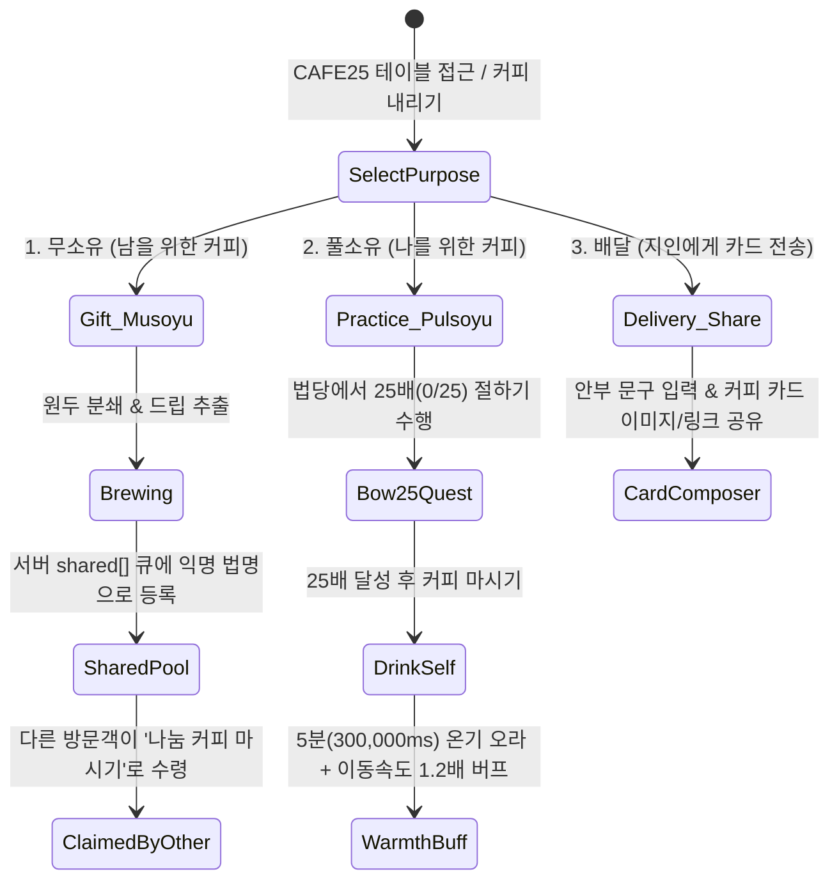
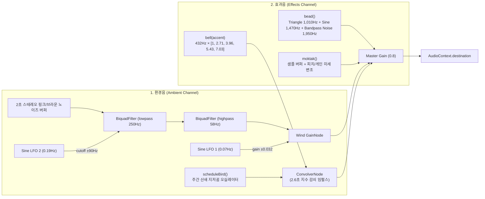

# 03. 수행(Practice) 인터랙션 · CAFE25 · Web Audio 절차적 사운드 엔진 분석

> **근거 증거 (Evidence IDs)**:
> - `ev_4086dde464e9b39caa6eb04e1572ae9c8eab322aa3c4e8a746acbf64241a506d` (HUD DOM 구조, 모달 다이얼로그, `localStorage` 키)
> - `ev_88ba890507c24458b1f176133a7cf9b7dc45571aafadaf54ee2a7d0410f4bceb` (`game-vJmMAgmy.js` 내 수행 상태 머신, `class pP` Web Audio 엔진, CAFE25 로직)

---

## 1. 6대 수행(Practice) 인터랙션 및 상태 머신 (`Observed`)

하단 액션 바(`nav.game-modes`)와 불단 컨텍스트 컨트롤(`.devotional-controls`)을 통해 6가지 핵심 수행이 동작합니다.

### 1.1 합장 인사 (`#hello`, 단축키 `3`)
* 실행 시 아바타가 두 손을 가슴 앞에 모으고 고개를 숙이는 합장 모션을 취하며, WebSocket으로 `{"type":"hello"}` 이벤트를 전송합니다.
* 주변 방문객 화면에서도 해당 아바타 위에 잔잔한 합장 파동 이펙트가 표시되고 절차적 종소리(`bell()`)가 울립니다.

### 1.2 절하기 (`#game-bow`, `data-mode="kneel"`, 단축키 `1` / `E` / `Space`)
* **단일 절 사이클 타임라인 (`4,800ms` + 휴식 `400ms`)**:
  `game-vJmMAgmy.js`에 정의된 절 애니메이션 키프레임 구간은 다음과 같습니다:
  - `0.00s ~ 0.55s` (`prepare`): 합장 후 무릎을 굽힐 준비
  - `0.55s ~ 2.25s` (`lowerEnd`): 무릎을 꿇고 이마와 두 손을 바닥(좌복)에 완전히 낮춤 (오체투지 자세)
  - `2.25s ~ 2.90s` (`holdEnd`): 바닥에 엎드린 채로 고요히 머무름
  - `2.90s ~ 4.80s` (`end`): 천천히 몸을 일으켜 다시 합장 자세로 복귀
  - `4.80s ~ 5.20s` (`rest: 0.4s`): 연속 절하기 시 다음 절 사이의 호흡 구간
* **카운팅 및 영속화**:
  - 절 1회가 완료될 때마다 상단 `#bow-counter`(`절 N배`)가 증가하며, `localStorage`에 누적 절 횟수가 저장됩니다.
  - 원격 방문객에게는 바이너리 레코드의 `hasBow = 1` 및 `bowAt` 서버 타임스탬프가 전달되어, 방 안의 모든 사람에게 동일한 위상(Phase)으로 절하는 모습이 동기화됩니다.

### 1.3 염주 돌리기 (`data-mode="beads"`, 단축키 `2`)
* 활성화 시 `#beads-host` 오버레이(`.sansa-beads-view`)가 열리며 화면 우측에 108염주 캔버스(`.sansa-beads-canvas`)가 나타납니다.
* **조작 메커니즘**:
  - 마우스 휠, 포인터 세로 드래그, 또는 `Space` / `↑` / `↓` 키로 염주 알을 위에서 아래로 한 알씩 넘깁니다.
  - 한 알을 넘길 때마다 `bead()` 효과음이 재생되고 `#beads-count`(`N알`)가 증가합니다.
  - **108알**을 모두 넘길 때마다 `#beads-rounds`(`108염주 N바퀴`)가 1 증가하고 청아한 범종 소리가 울립니다.

### 1.4 목탁 두드리기 (`#game-moktak`, 단축키 `5`)
* 활성화 시 `#moktak-host` 오버레이(`.sansa-moktak-view`)가 열리며 3D/캔버스 목탁이 표시됩니다.
* **수동 타격 & 108 BPM 자동 목탁**:
  - 목탁 화면을 직접 터치/클릭하거나 `Space` 키를 눌러 원하는 박자로 두드릴 수 있습니다.
  - `108 BPM 자동`(`data-moktak-auto`) 버튼을 켜면 $\frac{60{,}000}{108} \approx 555.56\text{ms}$ 주기로 일정하게 목탁을 두드리며 명상 호흡을 돕습니다.

### 1.5 향 올리기 (`incenseQueue`) & 복전함 (`#support-dialog`)
* **불단 헌향 대기열 시스템**:
  - 법당(`hall`) 불단 앞 향로는 한 번에 1명만 헌향할 수 있도록 서버/클라이언트 대기열(`incenseQueue`)로 관리됩니다.
  - 차례가 되면 아바타가 향로 앞으로 걸어가 향을 꽂고 합장하며, 향로에서 피어오르는 연기 파티클이 짙어집니다.
* **복전함 (`#support-dialog`)**:
  - 법당 복전함 클릭 또는 상단 `공양하기` 버튼 클릭 시 열립니다.
  - 토스뱅크 계좌번호 복사(`1002-194-419130`), 카카오페이 송금 QR 코드, 해외 방문객용 Buy Me a Coffee 링크를 제공합니다.

---

## 2. CAFE25 × 산사 커피 공양 시스템 (`Observed`)

마당(`garden`)의 CAFE25 공간에서는 커피를 매개로 한 세 가지 명상적 상호작용이 이루어집니다:

1. **무소유 (`gift` — 남을 위해 내리는 커피)**:
   - 내가 마시지 않고 산사에 머무는 누군가를 위해 정성껏 커피를 내려 `cafe25-state.shared` 목록에 올립니다.
   - 다른 방문객이 마당에서 `나눔 커피 마시기`(`#cafe25-context-claim`)를 누르면 *"따스한 솔바람님이 내려둔 커피를 마셨습니다"*와 같은 알림과 함께 온기를 전달받습니다.
2. **풀소유 (`practice` — 25배 수행 후 내가 마시는 커피)**:
   - 커피를 마시기 위해 **25배 절하기(`#game-bow25`, `0/25`)** 수행 과제가 부여됩니다.
   - 25배를 완수하고 커피를 마시면 `Iy = 300_000ms` (5분) 동안 캐릭터 주변에 따뜻한 온기 효과가 돌며 **걷기/이동 속도가 `1.2배` 빨라지는 버프**가 적용됩니다.
3. **배달 (`delivery` — 산사 밖 지인에게 보내는 커피 카드)**:
   - 짧은 안부 인사말을 적어 캔버스로 렌더링된 산사 커피 일러스트 카드 이미지를 저장하거나 공유 링크로 전달합니다.

---

## 3. Web Audio API 절차적 사운드 합성 엔진 (`class pP`, `Observed`)

`game-vJmMAgmy.js`의 `class pP`는 외부 스트리밍 의존성을 최소화하고 자연스러운 공간감을 만들기 위해 **Web Audio API 노드 그래프**로 사운드를 실시간 합성합니다.

### 3.1 3채널 오디오 상태 영속화 (`localStorage`)
`ev_4086dde4...` 스토리지 캡처에서 확인된 3개의 독립 채널 키:
- `sansa:ambient-enabled`: 환경음 (기본값 `"1"` 켜짐 — 산사 바람 소리 + 산새 소리)
- `sansa:chant-enabled`: 염불 소리 (기본값 `"0"` 꺼짐 — 개인 염불 & 매일 KST `05:00 · 18:00` 합동 염불)
- `sansa:effects-enabled`: 효과음 (기본값 `"1"` 켜짐 — 범종, 염주 알, 목탁, 발걸음)

### 3.2 합성 알고리즘 상세 (`class pP` 역공학 복원)

1. **산사 바람 소리 (`setupAmbient`)**:
   - 2초 길이의 스테레오 노이즈 버퍼를 생성하되, 이전 샘플과 현 샘플을 `prev = prev * 0.985 + white * 0.08`로 적분하여 부드러운 브라운/핑크 노이즈 질감을 만듭니다.
   - `250Hz` 로우패스 필터와 `58Hz` 하이패스 필터를 거친 뒤, `0.07Hz`와 `0.19Hz`의 초저주파 사인파 LFO 2개가 각각 음량과 필터 컷오프 주파수(`±90Hz`)를 서서히 흔들어 실제 산사의 바람이 불어왔다 잦아드는 소리를 무한 생성합니다.
2. **절차적 범종/인경 소리 (`bell(accent)`)**:
   - 기본 주파수 `432Hz`(강조 시 `528Hz`)에 대해 사찰 범종 특유의 비정수 배음 비율 **`[1, 2.71, 3.96, 5.43, 7.03]`**을 가진 5개의 사인파 오실레이터를 동시에 발진시킵니다.
   - 고차 배음일수록 빠르게 감쇠(`1.8초 / (i + 1)`)시키고 1차 배음은 길게 여운을 남겨(`2.6초` 컨볼루션 리버브 통과) 맑고 깊은 사찰 종소리를 재현합니다.
3. **염주 알 부딪히는 소리 (`bead()`)**:
   - `1,010Hz` 삼각파(Triangle)와 `1,470Hz` 사인파가 `36ms` 동안 급격히 피치 다운(`510Hz`, `760Hz`)되면서 `1,950Hz` 밴드패스 노이즈(`45ms`)와 섞여 단단한 나무 염주 알이 부딪히는 타격음을 만듭니다.
